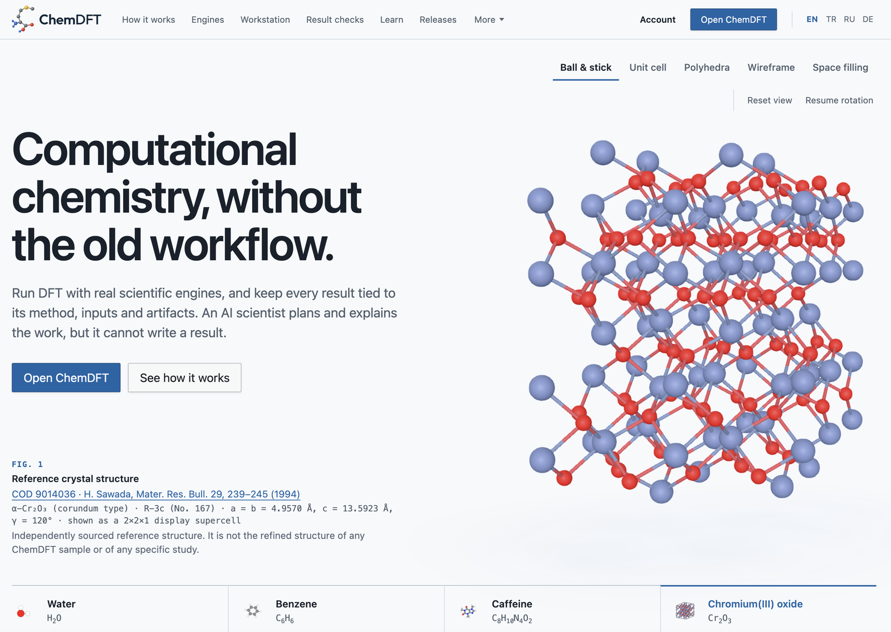
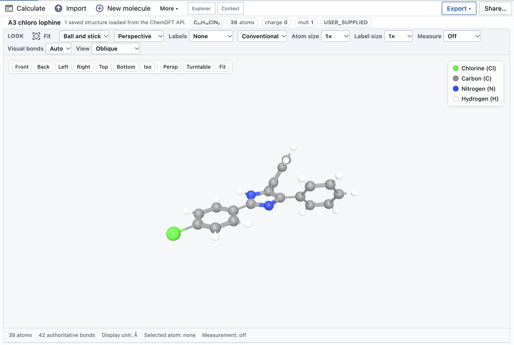
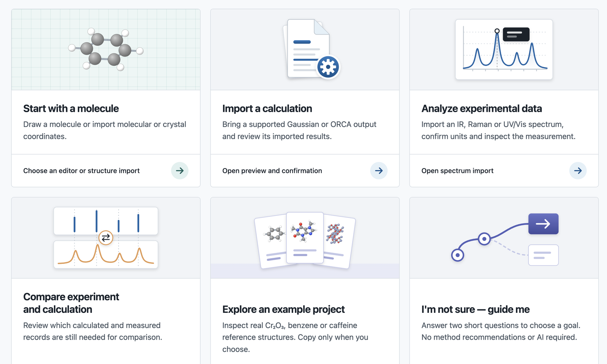
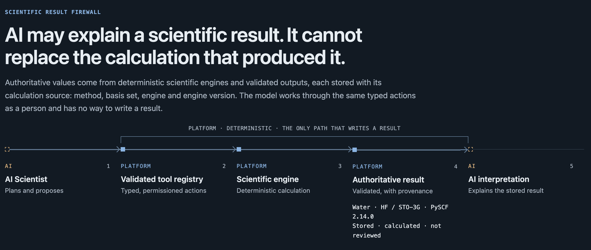
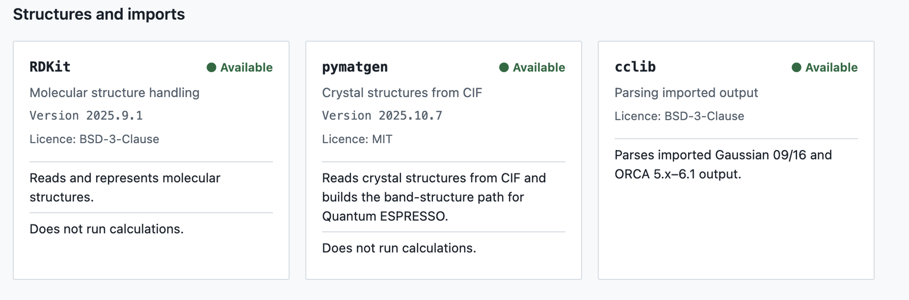
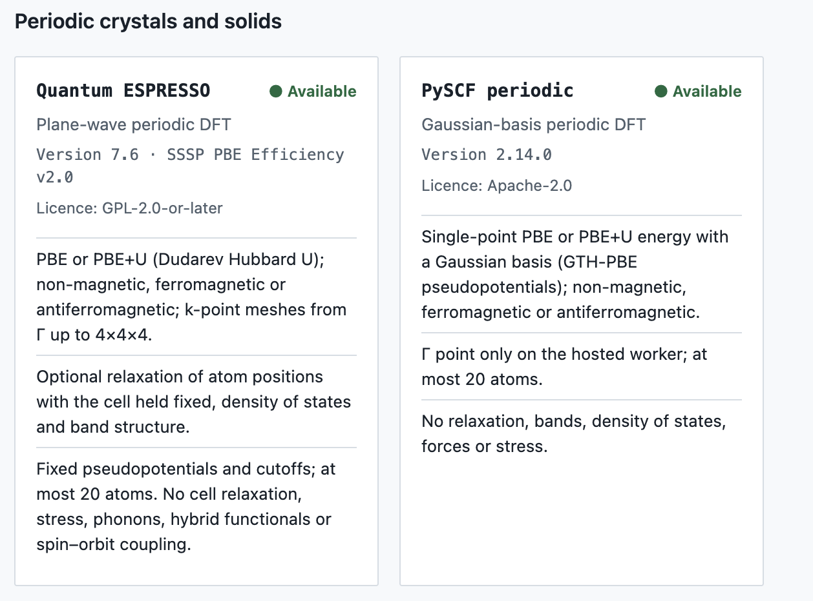
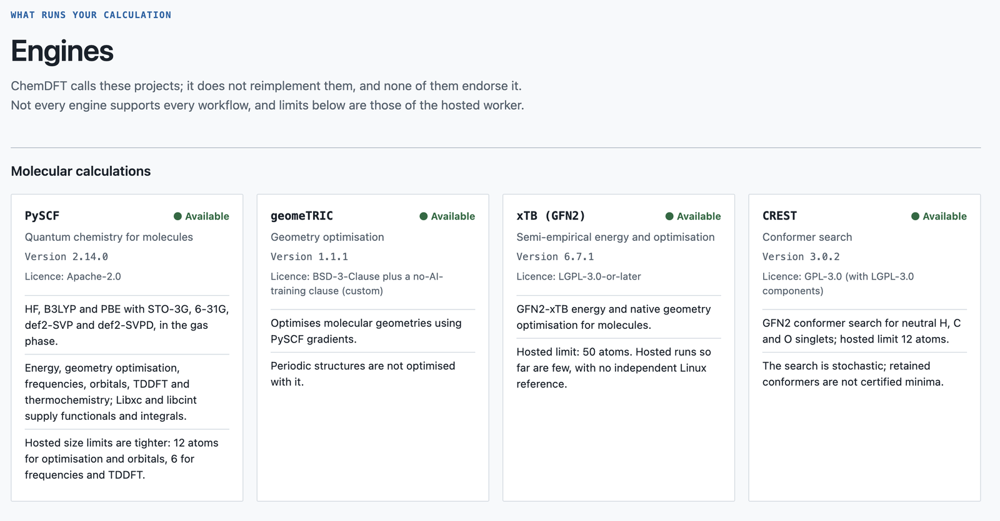

# ChemDFT

Website: https://chemdft.com · Public source: https://github.com/TabAh007/chemdft-open

ChemDFT is a web platform for computational chemistry and materials science. An AI assistant plans and explains; every
scientific value comes from a real engine (PySCF, Quantum ESPRESSO, xTB, CREST) and passes through a **Result Firewall**
that records where it came from. Hosted service: <https://chemdft.com>.

**Long-term goal:** a free, open tool for the kind of work people do today with Gaussian-like packages. This is a goal,
not a promise: there are no dates and no committed system sizes.

## Screenshots

| Screenshot | Description |
|---|---|
|  | **Homepage hero:** interactive 3D crystal viewer displaying a chromium(III) oxide reference structure alongside introductory overview. |
|  | **3D molecular workspace:** ball-and-stick structure viewer with orientation controls, atom size, bond settings, and element legend. |
|  | **Project start options:** choices for starting with a molecule, importing calculation outputs, analyzing experimental spectra, comparing results, exploring examples, or guided workflow. |
|  | **Scientific Result Firewall:** platform workflow separating AI planning and interpretation from deterministic calculation execution and recorded results. |
|  | **Structure toolkits and parsers:** status and capability cards for RDKit, pymatgen, and cclib output parsing. |
|  | **Periodic calculations:** cards for Quantum ESPRESSO plane-wave DFT and PySCF periodic Gaussian-basis calculations with listed options. |
|  | **Molecular calculation engines:** cards showing PySCF, geomeTRIC, xTB, and CREST versions, capabilities, and hosted limits. |

## Status

**Public beta.** The hosted service is run by one person and has deliberately small limits. What it accepts today
(from `apps/web/src/lib/hosted-limits.ts`):

| Calculation | Hosted limit |
|---|---|
| PySCF geometry optimisation, molecular orbitals | up to 12 atoms |
| PySCF frequencies, TD-DFT | up to 6 atoms |
| xTB energy and optimisation | up to 50 atoms |
| CREST conformer search | up to 12 atoms, neutral, H/C/O only, singlets |
| Quantum ESPRESSO periodic DFT | up to 20 atoms |

Beyond these numbers nothing is claimed: a feature is only described as verified in the release notes when it has been
run and checked, with platform and engine named. Self-hosted limits are whatever your own machine can do.

## The one rule

No language model ever produces a scientific value. Engines calculate; the AI Scientist plans and explains; the Result
Firewall records provenance for every number. A result that did not converge, or that contradicts its own engine log, is
refused rather than published. See [docs/02_SCIENTIFIC_INTEGRITY.md](docs/02_SCIENTIFIC_INTEGRITY.md).

## What is in this repository

The first-party code: the Next.js web app and molecule editor (`apps/web`), the API, AI gateway, compute gateway and
engine wrappers (`services/`), shared schemas and packages (`packages/`), examples, scripts, tests and the documentation
(`docs/`).

**Not in this repository:** the third-party engines themselves (PySCF, xTB, CREST, Quantum ESPRESSO and their
pseudopotentials are installed separately and keep their own licences); the CREST source and patches; the ChemDFT logo and
icons; retained evidence and build output; the AWS deployment scripts and the maintainer's internal operating notes. This
repository is an export without history, so it is not a mirror of the maintainer's private working repository.

## Self-hosting

Short version (full guide: [docs/SELF_HOSTING.md](docs/SELF_HOSTING.md)):

```bash
pnpm install
export CHEMDFT_DATABASE_URL="sqlite:///./.chemdft/chemdft.db"
export CHEMDFT_AUTO_CREATE_SCHEMA=true CHEMDFT_DEV_IDENTITY_ENABLED=true
export CHEMDFT_OBJECT_ROOT=./.chemdft/objects
uv run --project services/api chemdft-api          # API on http://127.0.0.1:8000
CHEMDFT_API_BASE_URL=http://127.0.0.1:8000 CHEMDFT_DEV_IDENTITY_ENABLED=true pnpm dev
```

Real calculations need the optional engines; without them the panel says the engine is unavailable and never fakes a
result. `docker-compose.selfhost.yml` starts an optional local Postgres.

**What was not verified:** the Postgres compose file has not been run against ChemDFT (Docker was unavailable when it was
written); SQLite is the tested path. The commands above were not re-run on the exported tree for this README. The hosted
deployment (AWS, Vercel) is not part of this repository and is not reproducible from it.

## Licence

Apache-2.0 for all first-party code and documentation ([LICENSE](LICENSE), [NOTICE](NOTICE), [REUSE.toml](REUSE.toml)).
Third-party engines and libraries keep their own licences and are never relicensed here. The map and the open legal
questions are in [docs/implementation/RELEASES_AND_LICENSE.md](docs/implementation/RELEASES_AND_LICENSE.md); no legal
review has taken place.

**geomeTRIC** is optional and not installed by default: its licence forbids use in AI-training datasets. Install it
deliberately with `uv sync --project services/scientific-worker --extra optimization` if you want PySCF geometry
optimisation, and do not put it into a training set.

## Citation

Cite the software with the all-versions DOI [10.5281/zenodo.24082321](https://doi.org/10.5281/zenodo.24082321). Version DOIs
and machine-readable metadata are in [CITATION.cff](CITATION.cff).

## Contributing

[CONTRIBUTING.md](CONTRIBUTING.md) (including how to declare AI assistance), [CODE_OF_CONDUCT.md](CODE_OF_CONDUCT.md),
[SECURITY.md](SECURITY.md), [GOVERNANCE.md](GOVERNANCE.md).

## AI authorship

A large part of this code was written by AI coding agents under the owner's direction. This is disclosed rather than
hidden: [docs/AI_DISCLOSURE.md](docs/AI_DISCLOSURE.md).
